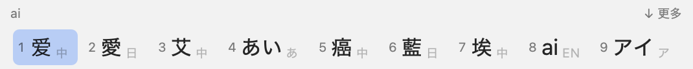
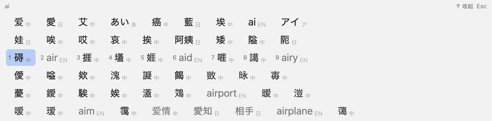

# Tatakikun

**English** | [简体中文](README.zh-CN.md) | [日本語](README.ja.md)

A macOS input method that reads what you type in English letters three ways at once — as an
English word, as Chinese pinyin and as Japanese romaji — and offers English, Chinese, hiragana,
katakana and Japanese kanji candidates side by side in one horizontal bar. The letters as typed
are always one of the candidates.





## Build and install

**Installer.** `scripts/make-installer.sh` builds `build/Tatakikun-<version>.pkg` (for Apple silicon
and Intel Macs). Open it: on the **Customize** page, check the language packs you want — Chinese,
Japanese, English, Spanish, French, Hindi (all checked by default). It installs for your user only, no administrator
password. To change the languages later, run the installer again; packs you uncheck are removed.

The package is not signed with an Apple Developer ID. A copy built on your own Mac opens normally;
a downloaded one is blocked the first time: open System Settings → Privacy & Security and click
**Open Anyway**.

**From the source folder**, without the installer:

```sh
scripts/build.sh            # the app and the language packs (first run downloads the open data, ~80 MB)
scripts/install.sh          # all the packs; or e.g. scripts/install.sh zh,en
```

Then add it once: System Settings → Keyboard → Text Input → Input Sources → Edit… → + →
Chinese, Simplified (简体中文) → Tatakikun. If it is not listed yet, log out and back in.

Both ways also add a login item that starts Tatakikun when you log in: macOS only starts an input method when a text field asks for it, and right after login that request is lost, so typing did nothing until you changed windows. It shows under System Settings → General → Login Items & Extensions → Allow in the Background, where you can turn it off.

Try it without installing: `TATAKIKUN_PACKS=build/packs .build/release/Tatakikun --demo`.

## Keys

| Key | While typing |
| --- | --- |
| letters | add to the input |
| Space | insert the highlighted candidate (the first one unless moved); after an English word, a space too (punctuation like `,` `.` typed next takes its place) |
| Return | insert the letters exactly as typed |
| 1–9 | insert that candidate of the highlighted row |
| ← → | move the highlight |
| ↓ or Tab | expand the bar downward into more rows (then move down a row); the rows scroll |
| ↑ | move up a row; from the first row, collapse |
| Backspace | remove the last letter |
| Esc | collapse when expanded, otherwise cancel |
| click | insert the clicked candidate |
| punctuation | insert the highlighted candidate, then the punctuation: full-width after a Chinese or Japanese candidate (`，` `。` / `、` `。` `「」`), as typed after an English one |
| n before a vowel | both readings are looked up: `unei` offers 運営 (うんえい) as well as うねい, `renai` 恋愛; `unnei` works too |
| - after romaji | the long vowel mark ー, as in other Japanese input methods (`sute-tasu` → ステータス, `ko-hi-` → コーヒー) |

Not typing, punctuation and Space follow the text before the cursor: full-width (`，` `、` and a full-width space) after Chinese or Japanese, as typed after English.

## Candidate order

The bar is ordered by cost (how common each word is), with two guarantees: the best candidate of
every language that matched (EN, 中, 日 kanji, あ hiragana, ア katakana) is in the bar, and so are
the letters as typed — ranked like any English word when they are one, otherwise in the last place.

Expanded rows also hold partial matches (shown in gray): words that complete what you typed
(`zhongg` → 中国, `compu` → computer, `arigat` → ありがとう), English spelling suggestions, and
words that cover only the start of the letters (`nihaoma` → 你好); choosing one of those inserts it
and keeps the remaining letters (`ma`) to go on typing. When nothing matches all the letters yet,
the bar itself shows the best partial matches.

Tatakikun follows what you are typing: right after you insert a word in one language, the best
candidate in that language comes first for the next word (so in "is a hen", hen comes before 很),
for 60 seconds or until you switch to another app.

Tatakikun learns: a candidate you choose ranks higher the next time you type the same letters.
A Chinese or Japanese result of 2 to 4 characters that you build from several picks, or pick from
further down than first, becomes a word of its own: typing the same letters again offers it as one
candidate, first. What it learned stays on this Mac in `~/Library/Application Support/Tatakikun/`,
in `history.tsv` and `custom-words.tsv`; delete those files to forget it.

## Dictionaries

Each language is a **language pack**, installed in
`~/Library/Application Support/Tatakikun/Packs/<zh|ja|en>`; a language without its pack offers no
candidates (the letters as typed are always offered).

| Pack | Built from | License |
| --- | --- | --- |
| Chinese | [pinyin-data](https://github.com/mozillazg/pinyin-data) (every reading of every character), [phrase-pinyin-data](https://github.com/mozillazg/phrase-pinyin-data) (readings of ~400,000 words), word frequencies from ICU and [jieba](https://github.com/fxsjy/jieba) | MIT; Unicode License V3 |
| Japanese | [Mozc OSS dictionary](https://github.com/google/mozc/tree/master/src/data/dictionary_oss) (~1 million words with readings), ICU's word list and frequencies | IPAdic license and others (see its README); Unicode License V3 |
| English | [SCOWL](http://wordlist.aspell.net/), its size levels as word frequencies | SCOWL's permissive license |
| Spanish | the words of [Mozilla Common Voice](https://github.com/common-voice/common-voice)'s sentences, counted for their frequencies, typed without accents (cancion → canción) | CC0 1.0 |
| French | the same, from Common Voice's French sentences (ecole → école, coeur → cœur, cest → c'est) | CC0 1.0 |
| Hindi | words and frequencies from Common Voice's Hindi sentences, typed by sound: spellings from a table of the letters, and the ones people use from [AI4Bharat Aksharantar](https://huggingface.co/datasets/ai4bharat/Aksharantar) (namaste → नमस्ते, kya → क्या) | CC0 1.0, CC BY 4.0 |

`scripts/fetch-sources.sh` downloads the data, pinned to exact versions and checked against SHA-256
sums; `scripts/build-packs.sh` builds the packs into `build/packs`, each with a LICENSE.txt for its
data. The ICU part comes from this Mac (`/usr/share/icu`): `tatakikun-dictgen` reads its CJK word
list into `build/dict`. Dictionaries are `.ttkd` files that are memory-mapped, so Tatakikun starts
instantly however large they are. None of the data or the packs is in this repository.

## iPhone and iPad (preview)

`iOS/` holds an iOS app with a Tatakikun keyboard (iOS 16 or later): the same engine and language
packs, a candidate bar over a QWERTY layout. Tap a candidate, or Space for the first one; return
inserts the letters as typed; ⌄ shows more candidates; `，` and `。` follow the language like on the Mac.

```sh
scripts/build-ios.sh        # build for the simulator (needs build/packs; XcodeGen to regenerate the project)
scripts/build-ios.sh test   # and run the UI tests
```

Open `iOS/Tatakikun.xcodeproj` in Xcode to run it on your own iPhone (sign with your Apple ID), then
turn it on: Settings → General → Keyboard → Keyboards → Add New Keyboard… → Tatakikun. The app also
has a screen to try the keyboard without turning it on. It is not on the App Store.

## Android (preview)

`android/` holds an Android app with a Tatakikun keyboard (Android 9 or later, arm64 phones):
the same engine as on the Mac, built with the Swift SDK for Android and reached through JNI, a
candidate bar over a QWERTY layout, and the language packs inside the app. It also reads a
hardware keyboard.

```sh
scripts/build-android-app.sh            # android/app/build/outputs/apk/debug/app-debug.apk
scripts/build-android-app.sh install    # and install it on a connected phone or a running emulator
scripts/test-android.sh                 # type a few inputs on the emulator and check the results
```

Building needs the Android SDK and NDK (Android Studio), and the Swift toolchain and Swift SDK for
Android that match each other (see `scripts/build-android.sh`). On the phone: open Tatakikun → Open
settings → turn on Tatakikun, then Choose keyboard → Tatakikun.

## Development

- `swift test` — engine, key-handling and pack tests (needs `build/dict` and `build/packs`: run `scripts/build.sh` first).
- `swift run -c release tatakikun-cli --packs build/packs nihao ai toukyou` — print candidates.
- `.build/release/Tatakikun --snapshot <letters> out.png [dark]` — draw the candidate bar to an image.

## License

MIT — see [LICENSE](LICENSE). The language packs are not part of this repository; each carries the
license of the data it is built from (see Dictionaries above).
